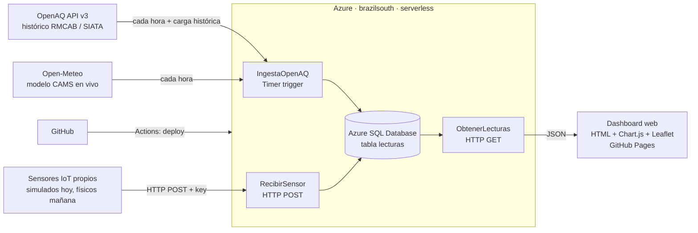

# AireLocal: comparador de calidad del aire en Bogotá

**Datos abiertos oficiales (OpenAQ / RMCAB) frente a sensores IoT hiperlocales, en una arquitectura 100 % serverless en Azure.**

> Proyecto universitario de Ingeniería en Telecomunicaciones (Universidad Militar Nueva Granada).

- **Dashboard público:** `docs/index.html` (publicado con GitHub Pages)
- **API pública:** `https://func-calidadaire-f6zo9.azurewebsites.net/api/lecturas?ciudad=Bogota&parametro=pm25`

---

## 1. El problema y la idea de negocio

Bogotá tiene unas 20 estaciones oficiales de la **RMCAB** (Red de Monitoreo de Calidad del Aire de Bogotá). Son confiables, pero están dispersas: un colegio, un parque o una zona industrial pueden quedar a varios kilómetros de la estación más cercana, y la contaminación del aire, sobre todo el PM2.5 del tráfico y la industria, cambia mucho de una cuadra a otra.

**AireLocal** compara los datos oficiales con **sensores IoT propios** de bajo costo instalados justo donde se necesita la información. Así responde a una pregunta concreta: *¿el aire que respiran los niños de este colegio es mejor o peor que el que reporta la estación oficial?*

### Hallazgo: los datos abiertos oficiales están desactualizados

Durante el desarrollo se encontró que las estaciones oficiales ya no publican en OpenAQ:

| Red | Estaciones en OpenAQ | Último dato publicado |
|---|---|---|
| RMCAB (Bogotá) | 19 | abril de 2022 |
| SIATA (Medellín) | 34 | septiembre de 2024 |
| Cali | sin red oficial en OpenAQ | — |

En toda Colombia solo 3 sensores (AirGradient, no oficiales) reportaron en la semana de la prueba. Por eso el sistema usa **tres fuentes**:

| `fuente` | Origen | Uso |
|---|---|---|
| `openaq` | OpenAQ API v3: histórico oficial RMCAB/SIATA más los sensores que sigan activos | Línea base histórica (perfil horario) |
| `modelo` | [Open-Meteo Air Quality](https://open-meteo.com/en/docs/air-quality-api), modelo CAMS de Copernicus | Referencia en vivo cada hora |
| `propio` | Sensores IoT propios | Medición hiperlocal |

Este vacío de datos abiertos actualizados **refuerza el caso de negocio**: hace falta una red de sensores propia para tener información de calidad del aire a nivel de barrio.

### Modelo de negocio (tipo TDT)

| Actor | Qué recibe | Qué paga |
|---|---|---|
| Ciudadano | Dashboard público y gratuito | Nada |
| Colegios / alcaldías locales | Monitoreo de su zona y alertas para la comunidad | Patrocinio del sensor y del servicio |
| Empresas (RSE ambiental) | Evidencia medible de su impacto y visibilidad como patrocinador | Patrocinio de sensores en su área de influencia |

Funciona como la **televisión digital terrestre (TDT)**: el público recibe la señal gratis y los patrocinadores sostienen la infraestructura.

## 2. Cómo se cumple el enunciado

| Requisito | Implementación |
|---|---|
| Clonar la base de datos de una página | Se replica en Azure SQL el **esquema de OpenAQ** (estación, contaminante, valor, ubicación, fecha): ver `sql/schema.sql` |
| Open data | Datos reales de **OpenAQ** (histórico oficial RMCAB y SIATA, unas 37 000 mediciones horarias) y de **Open-Meteo** (en vivo) |
| API | Consumo de las APIs públicas **OpenAQ v3** y **Open-Meteo**, y una API REST propia (`/api/lecturas`, `/api/sensor`) |
| Big Data (a escala educativa) | Ingesta continua cada hora de 3 ciudades y 6 contaminantes, con carga histórica masiva y análisis agregado (perfil horario por fuente), siguiendo el patrón **ingesta → almacenamiento → análisis** |
| Tema comercial con IoT | Sensores propios comparados con los oficiales y modelo de patrocinio tipo TDT |
| GitHub | Este repositorio, con despliegue continuo por GitHub Actions y dashboard en GitHub Pages |
| Resiliencia | Si OpenAQ, una estación o una ciudad fallan, la ingesta sigue con el resto. Hay reintentos ante errores 429/5xx de OpenAQ y reintentos con backoff si la base SQL serverless se está reanudando |
| Escalabilidad | Autoescalado nativo de **Azure Functions Flex Consumption**: de 0 a N instancias sin configurar nada |

## 3. Arquitectura



**¿Por qué serverless y no Docker/Kubernetes?** Fue una decisión deliberada. Azure Functions y Azure SQL son servicios administrados que ya traen autoescalado, alta disponibilidad, parches y monitoreo (Application Insights). Para el tamaño de este proyecto, orquestar contenedores solo añadiría costo y complejidad operativa sin ningún beneficio.

### Recursos en Azure

| Recurso | Nombre | Detalle |
|---|---|---|
| Resource group | `rg-calidadaire-bog` | Región `brazilsouth`, la más cercana a Colombia de las permitidas por la suscripción Azure for Students |
| Azure SQL Server | `sql-calidadaire-f6zo9` | Firewall: solo servicios de Azure |
| Azure SQL Database | `calidadaire` | Serverless GP_S_Gen5, **oferta gratuita** con auto-pausa al agotar el cupo (0 USD) |
| Function App | `func-calidadaire-f6zo9` | Python 3.11, plan **Flex Consumption** |
| Storage Account | `stcalidadairef6zo9` | Almacena el paquete y el estado de las funciones |
| Application Insights | `func-calidadaire-f6zo9` | Logs y métricas |

### Modelo de datos: tabla `lecturas`

| Columna | Tipo | Descripción |
|---|---|---|
| `id` | BIGINT IDENTITY | Llave primaria |
| `fuente` | VARCHAR(20) | `openaq` (estaciones), `modelo` (Open-Meteo) o `propio` (sensor IoT) |
| `ciudad` | VARCHAR(50) | Bogota, Medellin, Cali |
| `parametro` | VARCHAR(20) | pm25, pm10, o3, no2, co, so2… |
| `sensor_id` | VARCHAR(64) | Id del sensor en OpenAQ o del sensor propio |
| `estacion` | NVARCHAR(200) | Nombre de la estación o sitio |
| `unidad` | VARCHAR(20) | µg/m³, ppm… |
| `lat`, `lon` | FLOAT | Ubicación |
| `fecha` | DATETIME2 | Fecha de la medición (UTC) |
| `valor` | FLOAT | Valor medido |

Un índice único sobre `(fuente, sensor_id, parametro, fecha)` evita duplicados cuando la ingesta horaria vuelve a traer la misma medición.

## 4. Los tres microservicios (`api/function_app.py`)

### `IngestaOpenAQ`: timer, minuto 5 de cada hora
1. Busca en OpenAQ las estaciones en un radio de 25 km de cada ciudad (`/v3/locations`).
2. Descarta las que llevan más de 14 días sin reportar.
3. Pide la última medición de cada estación (`/v3/locations/{id}/latest`) y respeta el límite de 60 peticiones por minuto.
4. Trae de Open-Meteo las últimas 48 horas del modelo CAMS (PM2.5, PM10, O₃, NO₂, SO₂, CO) para cada ciudad.
5. Guarda todo en SQL en bloque, sin duplicar registros. Cada fuente y cada ciudad se procesan por separado: si una falla, las demás siguen.

### `CargaHistorica`: `POST /api/historico?ciudad=Bogota&dias=30` (utilidad, requiere master key)
Es una utilidad que se ejecuta una sola vez. Descarga de OpenAQ las mediciones horarias (`/v3/sensors/{id}/hours`) de los últimos `dias` que publicó cada estación oficial antes de dejar de reportar. Se ejecutó con `dias=30` para Bogotá (18 423 lecturas) y Medellín (19 236 lecturas).

### `RecibirSensor`: `POST /api/sensor?code=<function-key>`
Recibe una lectura o una lista de hasta 500, las valida (parámetro, rango, coordenadas) y las guarda con `fuente = 'propio'`.

```json
{ "sensor_id": "propio-colegio-kennedy", "ciudad": "Bogota", "parametro": "pm25",
  "valor": 31.2, "lat": 4.628, "lon": -74.153, "estacion": "Colegio distrital - Kennedy",
  "fecha": "2026-11-02T18:00:00Z" }
```
Respuestas: `201` guardado · `400` datos inválidos · `401` sin key · `503` base de datos no disponible.

### `ObtenerLecturas`: `GET /api/lecturas`
Parámetros: `ciudad` (por defecto Bogota), `parametro` (pm25), `horas` (48, máximo 720) y `fuente` (opcional). Es pública y tiene CORS habilitado para el dashboard.

Con `modo=perfil` devuelve el **promedio por hora del día** (hora de Bogotá) de cada fuente sobre todo el histórico. Con esto el dashboard compara a qué hora se respira peor aire según la red oficial, el modelo y los sensores propios.

## 5. Simulador de sensores IoT (`simulador/simulador_sensor.py`)

Simula tres sensores tipo PMS5003 en Bogotá: un colegio en Kennedy, el Parque Simón Bolívar y la zona industrial de Puente Aranda. Los valores siguen un patrón diario con picos de tráfico a las 7 a. m. y a las 6 p. m. Solo usa la librería estándar de Python, así que corre en **Azure Cloud Shell** sin instalar nada:

```bash
export FUNC_URL="https://func-calidadaire-f6zo9.azurewebsites.net/api"
export SENSOR_KEY=$(az functionapp function keys list -g rg-calidadaire-bog -n func-calidadaire-f6zo9 --function-name RecibirSensor --query default -o tsv)
python3 simulador/simulador_sensor.py --backfill 24   # historial de las últimas 24 h
python3 simulador/simulador_sensor.py --cada 300      # una lectura cada 5 minutos
```

Para pasar a hardware real (ESP32 + PMS5003), el firmware solo tiene que hacer el mismo `POST` con el mismo JSON.

## 6. Despliegue desde cero (Azure Cloud Shell)

```bash
RG=rg-calidadaire-bog; LOC=brazilsouth; SUF=<sufijo-unico>
az group create -n $RG -l $LOC
az sql server create -g $RG -n sql-calidadaire-$SUF -l $LOC -u <admin> -p '<password>'
az sql server firewall-rule create -g $RG -s sql-calidadaire-$SUF -n AllowAzureServices --start-ip-address 0.0.0.0 --end-ip-address 0.0.0.0
az sql db create -g $RG -s sql-calidadaire-$SUF -n calidadaire -e GeneralPurpose -f Gen5 -c 2 \
  --compute-model Serverless --use-free-limit --free-limit-exhaustion-behavior AutoPause
az storage account create -g $RG -n stcalidadaire$SUF -l $LOC --sku Standard_LRS
az functionapp create -g $RG -n func-calidadaire-$SUF --storage-account stcalidadaire$SUF \
  --flexconsumption-location $LOC --runtime python --runtime-version 3.11
az functionapp config appsettings set -g $RG -n func-calidadaire-$SUF --settings \
  "SQL_CONNECTION_STRING=Driver={ODBC Driver 18 for SQL Server};Server=tcp:sql-calidadaire-$SUF.database.windows.net,1433;Database=calidadaire;Uid=<admin>;Pwd=<password>;Encrypt=yes;" \
  "OPENAQ_API_KEY=<tu-api-key>"
az functionapp cors add -g $RG -n func-calidadaire-$SUF --allowed-origins "*"
cd api && zip -r ../api.zip . && cd ..
az functionapp deployment source config-zip -g $RG -n func-calidadaire-$SUF --src api.zip --build-remote true
```

La tabla `lecturas` se crea sola la primera vez que se ejecuta cualquiera de las funciones.

Carga del histórico oficial (una sola vez):
```bash
MK=$(az functionapp keys list -g $RG -n func-calidadaire-$SUF --query masterKey -o tsv)
curl -X POST "https://func-calidadaire-$SUF.azurewebsites.net/api/historico?ciudad=Bogota&dias=30" -H "x-functions-key: $MK"
curl -X POST "https://func-calidadaire-$SUF.azurewebsites.net/api/historico?ciudad=Medellin&dias=30" -H "x-functions-key: $MK"
```

> **Nota:** la suscripción Azure for Students de la universidad tiene una política que solo permite las regiones `westus2`, `brazilsouth`, `belgiumcentral`, `spaincentral` y `northcentralus`. Por eso falla la creación en `eastus` o `eastus2`.

### API key de OpenAQ
La API v3 de OpenAQ exige una key gratuita. Se obtiene creando una cuenta en <https://explore.openaq.org/register>, y la key aparece en *Account → API Key*. Se guarda como app setting `OPENAQ_API_KEY`, nunca en el código.

## 7. CI/CD con GitHub Actions

`.github/workflows/deploy-functions.yml` despliega la carpeta `api/` en cada push a `main`. Configuración (una sola vez):

1. Descargar el publish profile:
   `az functionapp deployment list-publishing-profiles -g rg-calidadaire-bog -n func-calidadaire-f6zo9 --xml`
2. En GitHub, ir a *Settings → Secrets and variables → Actions → New repository secret*, con nombre `AZURE_FUNCTIONAPP_PUBLISH_PROFILE` y como valor el XML completo.

**Dashboard:** en *Settings → Pages*, elegir *Deploy from a branch* → `main` → carpeta `/docs`.

## 8. Seguridad

- Los secretos (cadena de conexión SQL y API key) viven en los app settings de Azure y en `local.settings.json`, que está en `.gitignore`. No se suben al repositorio.
- `RecibirSensor` exige una function key, así que nadie puede inyectar lecturas falsas sin ella.
- `ObtenerLecturas` es de solo lectura, usa consultas parametrizadas y está limitada a 5000 filas.
- Azure SQL solo acepta conexiones desde servicios de Azure y siempre con TLS.

## 9. Costos estimados

| Servicio | Costo |
|---|---|
| Azure SQL (oferta gratuita, 100 000 vCore-s al mes) | 0 USD. Si se agota el cupo, la base se pausa en lugar de cobrar |
| Azure Functions Flex Consumption | Dentro de la capa gratuita para este volumen |
| Storage + Application Insights | Centavos de dólar al mes |

## 10. Estructura del repositorio

```
api/                  Azure Functions (Python v2): function_app.py, db.py
docs/index.html       Dashboard (Chart.js + Leaflet), servido por GitHub Pages
simulador/            Simulador de sensores IoT
sql/schema.sql        Esquema de la base (réplica del modelo OpenAQ)
.github/workflows/    CI/CD hacia Azure
```

## Créditos
- Datos: [OpenAQ](https://openaq.org) (CC BY 4.0), con datos de la RMCAB (Secretaría Distrital de Ambiente de Bogotá) y del SIATA (Medellín).
- Referencia en vivo: [Open-Meteo Air Quality API](https://open-meteo.com) (CC BY 4.0), basada en el servicio CAMS de Copernicus.
- Escala de calidad del aire: Resolución 2254 de 2017, Ministerio de Ambiente de Colombia.
